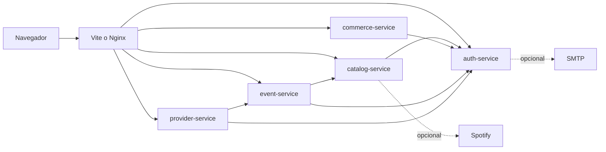

# Arquitectura

Cinco aplicaciones FastAPI expuestas por REST, con comunicación síncrona entre
servicios y persistencia SQLAlchemy.
El frontend React consume `/api/*`: Vite hace de proxy en desarrollo y Nginx
en Compose. No hay un API Gateway de negocio, cola ni RabbitMQ implementados.

Cada servicio tiene una instancia PostgreSQL independiente. No hay claves
foráneas entre bases: los identificadores externos se guardan como cadenas y
se comprueban mediante HTTP cuando lo requiere una operación.

| Servicio | Base en Compose | Tablas registradas |
|---|---|---|
| auth | subsonic_auth | users, revoked_tokens, password_resets, user_token_invalidations |
| catalog | subsonic_catalog | artists, songs |
| event | subsonic_events | events, schedule_entries, pass_configs, tickets |
| commerce | subsonic_commerce | products, product_variants, orders, order_items |
| provider | subsonic_providers | providers, external_services, spaces, space_proposals |

Auth gestiona registro, login, perfil y roles. Firma JWT HS256 y utiliza Argon2
para contraseñas. Los hashes de tokens revocados y de recuperación persisten en
su base; la recuperación caduca a los 15 minutos y no permite reutilizar el token.
Los otros servicios delegan la identidad en `GET /users/me`, reenviando el Bearer;
las operaciones de referencias pueden consultar además `GET /users/{id}`.

Event consulta el artista en catalog antes de añadir una actuación. Provider
consulta el evento antes de crear espacios o propuestas. Commerce conserva
referencias de productos en los pedidos para no perder el historial al retirar
un producto. Las transacciones son locales, sin coordinación distribuida.

La emisión de entradas es de desarrollo: no valida un pago mediante pasarela.
El comercio almacena el identificador de método de pago, pero no hay integración
con un proveedor de pagos. No se añade ninguna en este trabajo.

`generated/` contiene modelos, routers, implementaciones manuales, seguridad,
clientes HTTP y tests; su nombre no implica que sea reemplazable por generación.
Las especificaciones raíz son la fuente de verdad y sus copias se validan juntas.

El lifespan de cada API ejecuta `create_all` después de registrar sus modelos.
Sirve para bases vacías y es repetible, pero no transforma columnas existentes.
No hay Alembic ni una segunda estrategia de migraciones añadida.

`/health` es liveness del proceso. `/ready` comprueba únicamente la conexión
a su PostgreSQL local. La disponibilidad de auth, catalog, event, SMTP o Spotify
se gestiona durante las operaciones que los necesitan, no en un sondeo recursivo.
